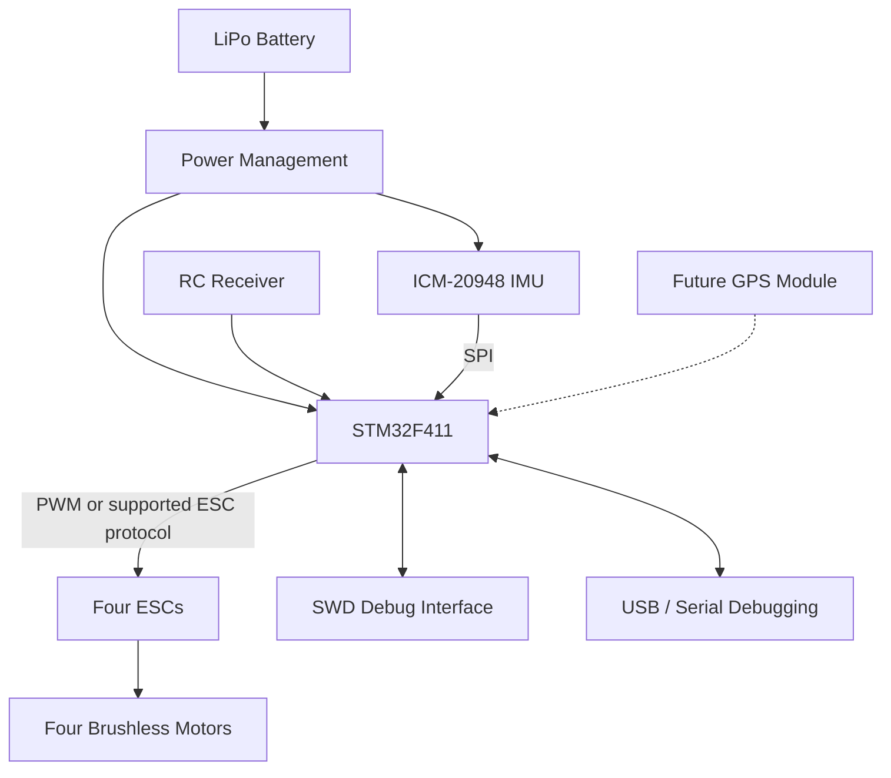

# STM32-Based Quadcopter Flight Controller

**A custom embedded flight controller built around the STM32F411 microcontroller, an ICM-20948 inertial measurement unit, and a custom-designed PCB.**

This project focuses on the design and development of a quadcopter flight controller, combining embedded C firmware, sensor interfacing, control-system development, power electronics, and printed circuit board (PCB) design.

The goal is to develop a custom hardware and firmware platform capable of reading inertial sensor data, estimating the drone's attitude, processing pilot commands, and controlling four electronic speed controllers (ESCs). The project is also intended to serve as a foundation for future autonomous flight and precision agriculture applications.

**Repository:** [stm32-based-quadcopter-drone](https://github.com/santhazsolt/stm32-based-quadcopter-drone)

---

## Table of Contents

- [Project Overview](#project-overview)
- [Project Objectives](#project-objectives)
- [System Architecture](#system-architecture)
- [Hardware Design](#hardware-design)
- [Power Management](#power-management)
- [Firmware Architecture](#firmware-architecture)
- [Flight Control Fundamentals](#flight-control-fundamentals)
- [Communication Interfaces](#communication-interfaces)
- [Development Tools](#development-tools)
- [Repository Structure](#repository-structure)
- [Development Workflow](#development-workflow)
- [Hardware Bring-Up and Testing](#hardware-bring-up-and-testing)
- [Current Development Status](#current-development-status)
- [Planned Improvements](#planned-improvements)
- [Safety Considerations](#safety-considerations)
- [Learning Outcomes](#learning-outcomes)
- [References](#references)
- [License](#license)

---

## Project Overview

Commercial flight controllers typically integrate a microcontroller, inertial sensors, power regulation, communication interfaces, and motor-control outputs on a single PCB.

This project explores how those components can be designed and integrated into a custom embedded system.

The hardware is built around the **STM32F411CEU6**, an ARM Cortex-M4 microcontroller with an FPU, hardware timers, SPI, UART, ADC, and other peripherals suitable for real-time embedded applications.

The controller interfaces with an **ICM-20948 9-axis IMU**, which combines a 3-axis accelerometer, a 3-axis gyroscope, and a 3-axis magnetometer. The sensor provides measurements that can be used for attitude estimation and flight stabilization.

The project covers two interconnected areas:

- **Hardware:** Schematic design, component selection, PCB layout, power distribution, signal interfacing, and hardware debugging.
- **Firmware:** Peripheral configuration, sensor drivers, inertial data processing, attitude estimation, control algorithms, and ESC signal generation.

The long-term objective is to develop a functional flight-control platform that can be extended with GPS navigation, autonomous flight, and aerial crop-monitoring capabilities.

## Project Objectives

The primary objectives are to:

1. Design a custom flight-controller PCB around the STM32F411.
2. Integrate an inertial measurement unit using SPI communication.
3. Develop embedded C firmware for sensor acquisition and peripheral control.
4. Establish the software architecture for attitude estimation and PID-based stabilization.
5. Generate control signals for four ESCs using STM32 hardware timers.
6. Integrate a radio-control receiver for manual pilot input.
7. Design a power architecture suitable for operation from a LiPo battery.
8. Establish a repeatable hardware bring-up and debugging procedure.
9. Build a modular platform that can support future autonomous navigation and precision agriculture applications.

---

## System Architecture

The flight controller is designed as a real-time embedded system. Its main responsibility is to process sensor measurements and pilot commands, calculate the required control response, and generate motor outputs.

### Main subsystems

| Subsystem        | Responsibility                                                                |
| ---------------- | ----------------------------------------------------------------------------- |
| STM32F411        | Main processor and real-time control                                          |
| ICM-20948        | Inertial measurements for attitude estimation                                 |
| RC receiver      | Pilot commands and manual control                                             |
| ESC interfaces   | Motor command generation                                                      |
| Power management | Battery input and regulated supply rails                                      |
| SWD interface    | Programming and low-level debugging                                           |
| USB interface    | Development, programming support, or diagnostics, depending on implementation |
| GPS module       | Planned navigation and position estimation                                    |

The architecture separates sensor acquisition, state estimation, control calculations, and actuator output. This separation makes the firmware easier to test, debug, and extend.

---

## Hardware Design

The hardware is being developed in KiCad, from the electrical schematic through PCB layout and manufacturing preparation.

### 1. Microcontroller

**STM32F411CEU6 — ARM Cortex-M4**

The STM32F411 is the central processing unit of the flight controller.

Key capabilities relevant to this project include:

- 32-bit ARM Cortex-M4 core with a floating-point unit.
- Hardware timers for precise timing and PWM generation.
- SPI for high-speed sensor communication.
- UART for serial communication with external modules.
- ADC for analog measurements, including battery-voltage monitoring.
- SWD for programming and debugging.

The exact peripheral allocation, clock configuration, timer assignments, and GPIO mapping are defined by the firmware and hardware design.

### 2. Inertial Measurement Unit

**ICM-20948 — 9-axis IMU**

The ICM-20948 provides:

- 3-axis accelerometer measurements.
- 3-axis gyroscope measurements.
- 3-axis magnetometer measurements.

The accelerometer measures specific force, including the influence of gravity. The gyroscope measures angular velocity. The magnetometer can provide heading-related information when properly calibrated and when magnetic interference is controlled.

The firmware is intended to use these measurements to estimate the drone's orientation.

The sensor communicates with the STM32 through SPI. Because the ICM-20948 has specific digital-I/O voltage requirements, the hardware design incorporates a dedicated 1.8 V supply and logic-level translation between the sensor and the 3.3 V microcontroller domain.

**Important:** Correct sensor identification, register access, initialization, data acquisition, and calibration must be verified on the actual hardware before the IMU can be considered operational.

### 3. Radio-Control Receiver

The controller is designed to accept pilot commands from a radio-control receiver.

The receiver interface is intended to provide the flight controller with inputs such as:

- Roll command.
- Pitch command.
- Yaw command.
- Throttle command.

The receiver protocol and electrical interface must match the selected receiver and firmware configuration. For an IBUS-based receiver, the firmware must correctly configure the appropriate UART, baud rate, packet parsing, and input-validation logic.

Receiver disconnection and invalid or stale commands should be handled explicitly before flight operation.

### 4. ESC and Motor Interfaces

The flight controller is designed to command four ESCs, each driving a brushless DC motor.

The intended quadcopter platform uses:

- Four brushless motors.
- Four ESCs.
- A quadcopter frame.
- A LiPo battery.

The ESC interfaces must use a signal format supported by the selected ESCs and configured in the firmware. PWM is a possible implementation, but the actual timer configuration and signal timings must be verified.

Motor order, rotation direction, and the relationship between motor outputs and the quadcopter's frame orientation must be documented and tested.

### 5. Programming and Debugging

The board is designed to support development and troubleshooting through:

- SWD programming and debugging.
- USB connectivity where supported by the implemented circuit.
- Measurement of regulated power rails.
- Inspection of digital signals with an oscilloscope or logic analyzer.
- Firmware logging and diagnostic output, where implemented.

These interfaces support verification of the power supply, MCU startup, sensor communication, and control-signal generation.

---

## Power Management

Power management is a critical part of the flight-controller design because the system combines a high-current battery-powered propulsion system with low-voltage digital electronics.

The hardware uses a staged power architecture.

| Power stage             | Component                                      | Purpose                                              |
| ----------------------- | ---------------------------------------------- | ---------------------------------------------------- |
| Battery input           | XT60 connector                                 | Main LiPo power connection                           |
| Input protection        | Fuse and reverse-polarity protection circuitry | Protect the input against specified fault conditions |
| Main DC-DC conversion   | TPS54331 buck converter                        | Generate the main regulated supply                   |
| 5 V to 3.3 V            | AMS1117 regulator                              | Supply the MCU and other compatible 3.3 V circuitry  |
| 3.3 V to 1.8 V          | TLV75518 regulator                             | Supply the ICM-20948 digital-I/O voltage domain      |
| Logic-level translation | Dedicated level-shifting circuitry             | Adapt signals between 3.3 V and 1.8 V domains        |

The final electrical behavior depends on the selected component variants, resistor values, capacitor values, PCB implementation, and load conditions.

### Design considerations

- Verify each supply rail before installing or enabling sensitive components.
- Check regulator input and output voltages under realistic loads.
- Confirm that the logic-level translator supports the required signal direction and SPI timing.
- Place decoupling capacitors close to the relevant IC supply pins.
- Keep high-current motor power paths separate from sensitive sensor circuitry as far as practical.
- Verify common-ground connections and the return paths for digital and power currents.
- Ensure the USB and battery power arrangements cannot unintentionally back-feed an external USB port.

The power architecture must be tested on the assembled board before the controller is connected to a battery-powered propulsion system.

---

## Firmware Architecture

The firmware is intended to be organized into independent modules, separating low-level hardware access from flight-control algorithms.

The exact module names and implementation status should follow the source code in the repository.

### 1. Hardware initialization

The initialization layer configures the STM32 peripherals required by the application.

Typical responsibilities include:

- System clock configuration.
- GPIO initialization.
- SPI initialization.
- UART initialization.
- Timer and PWM configuration.
- Interrupt configuration where required.

STM32CubeIDE and STM32CubeMX can be used to configure the device peripherals and generate the initial project configuration.

### 2. IMU driver

The IMU driver is responsible for communication with the ICM-20948.

Its intended responsibilities include:

- Reading the device identification register.
- Resetting and initializing the sensor.
- Configuring accelerometer and gyroscope ranges.
- Configuring the required operating modes.
- Reading sensor registers.
- Converting raw values into engineering units.
- Detecting communication errors.

The SPI interface should be verified independently before sensor-fusion or control algorithms are integrated.

### 3. Sensor calibration and filtering

Raw IMU measurements contain bias, noise, and other errors.

The sensor-processing layer is intended to support:

- Gyroscope bias estimation.
- Accelerometer offset or calibration procedures.
- Conversion from raw measurements to physical units.
- Filtering of noisy measurements.
- Validation of sensor readings.

A complementary filter or a suitable alternative can be used to combine accelerometer and gyroscope data for attitude estimation.

A magnetometer-based heading estimate requires additional calibration and appropriate handling of magnetic interference.

### 4. Attitude estimation

Attitude estimation calculates the orientation of the quadcopter from sensor measurements.

The firmware architecture can accommodate Euler-angle or quaternion-based representations.

The estimated state can provide roll, pitch, and yaw information for the control system. The selected algorithm must account for sensor coordinate conventions, sampling frequency, and numerical stability.

### 5. PID control

PID controllers can be used to reduce the difference between the desired and measured attitude or angular rate.

The general controller equation is:

[
u(t)=K_p e(t)+K_i\int e(t),dt+K_d\frac{de(t)}{dt}
]

where:

- (e(t)) is the control error.
- (K_p) is the proportional gain.
- (K_i) is the integral gain.
- (K_d) is the derivative gain.
- (u(t)) is the controller output.

The actual control architecture may use cascaded rate and attitude loops. Controller execution must use a known timing interval, and the implementation should include appropriate output limits, integral anti-windup, and handling of invalid sensor data.

PID control is a planned or developing subsystem until its implementation and behavior have been verified.

### 6. Motor mixing and output generation

The motor-mixing layer converts control commands into individual motor commands.

For a conventional quadcopter, this combines collective throttle with roll, pitch, and yaw corrections according to the selected frame configuration.

The mixing matrix must match the actual motor numbering, rotation directions, and frame geometry.

The output layer then converts the calculated commands into the electrical signals expected by the ESCs.

### 7. Safety and fault handling

A flight controller must detect conditions that make continued control unsafe.

The firmware should ultimately address:

- Invalid or unavailable IMU data.
- Sensor initialization failures.
- Radio-control signal loss.
- Invalid throttle or control inputs.
- Control-loop timing failures.
- Out-of-range actuator commands.
- Safe startup and motor arming conditions.

These mechanisms must be explicitly implemented and tested. Their presence should not be assumed solely from the firmware architecture.

---

## Flight Control Fundamentals

The intended control pipeline is:

1. Acquire sensor measurements.
2. Validate and calibrate the sensor data.
3. Estimate the vehicle's attitude or angular rate.
4. Decode pilot commands.
5. Calculate the control error.
6. Execute the relevant PID controllers.
7. Apply motor mixing and output limits.
8. Generate ESC signals.
9. Repeat at the configured control-loop rate.

The timing of this pipeline is as important as the individual algorithms. Sensor sampling, controller execution, and actuator updates should be coordinated to provide predictable behavior.

A control-loop frequency should be selected based on sensor configuration, processing requirements, and validated hardware performance rather than assumed in advance.

---

## Communication Interfaces

| Interface          | Intended use                                                              |
| ------------------ | ------------------------------------------------------------------------- |
| SPI                | ICM-20948 communication                                                   |
| UART               | RC receiver or serial peripherals                                         |
| PWM-capable timers | ESC command generation                                                    |
| ADC                | Battery-voltage measurement                                               |
| SWD                | Programming and debugging                                                 |
| USB                | Connectivity and development support, subject to the implemented hardware |

The STM32 peripheral mapping must be documented in the firmware configuration or a dedicated pin-assignment document. Exact pins and alternate functions should not be inferred from the component list alone.

---

## Development Tools

The project uses the following tools and technologies.

| Tool or technology            | Purpose                                          |
| ----------------------------- | ------------------------------------------------ |
| KiCad                         | Schematic capture and PCB design                 |
| STM32CubeIDE                  | Firmware development, compilation, and debugging |
| STM32CubeMX                   | Peripheral and clock configuration               |
| STM32CubeProgrammer           | Programming and device access                    |
| ST-LINK                       | SWD debugging and flashing                       |
| C                             | Embedded firmware development                    |
| Oscilloscope / logic analyzer | Hardware signal inspection                       |
| Git and GitHub                | Version control and project documentation        |

Relevant embedded topics include SPI, UART, ADC, timer configuration, PWM generation, sensor calibration, real-time control, and hardware debugging.

## Development Workflow

The project follows a hardware-and-firmware development process.

### Hardware development

1. Define system requirements and component interfaces.
2. Select the microcontroller, IMU, power components, connectors, and protection circuitry.
3. Design the electrical schematic in KiCad.
4. Perform electrical-rule checks and manually review critical circuits.
5. Assign and verify component footprints.
6. Transfer the schematic to the PCB editor.
7. Define the board outline, mounting holes, and connector locations.
8. Place components and route the PCB.
9. Perform design-rule checks and review manufacturing outputs.
10. Manufacture and assemble the PCB.
11. Bring up the board progressively, checking each supply rail and subsystem.

### Firmware development

1. Configure the STM32 clocks and peripherals.
2. Verify startup, programming, and debugging.
3. Test the SPI communication interface.
4. Implement and validate IMU initialization and data acquisition.
5. Verify calibration and sensor-data conversion.
6. Develop and test the attitude-estimation algorithm.
7. Implement control-loop timing and PID calculations.
8. Verify motor mixing and ESC signal generation without propellers.
9. Integrate the receiver and validate input handling.
10. Perform staged, controlled system testing.

Hardware and firmware development should proceed together so that electrical design decisions remain consistent with software requirements.

---

## Hardware Bring-Up and Testing

Testing should proceed from individual components to the complete flight-control system.

| Stage                  | Verification goal                                                       |
| ---------------------- | ----------------------------------------------------------------------- |
| 1. Power inspection    | Check for shorts, incorrect polarity, and assembly errors               |
| 2. Power rails         | Measure the regulated supplies and verify stability                     |
| 3. MCU startup         | Confirm that the microcontroller powers up and can be accessed over SWD |
| 4. SPI communication   | Verify electrical signals and successful sensor register access         |
| 5. IMU acquisition     | Confirm plausible, changing accelerometer and gyroscope readings        |
| 6. Sensor calibration  | Evaluate bias, noise, and orientation response                          |
| 7. Receiver interface  | Verify valid channel values and signal-loss detection                   |
| 8. ESC outputs         | Check output timing and channel mapping without propellers              |
| 9. Control algorithms  | Test filtering, controller calculations, and motor mixing               |
| 10. Integrated testing | Validate system behavior under controlled conditions                    |
| 11. Flight testing     | Proceed only after hardware, firmware, and safety checks pass           |

Test results should be recorded rather than assumed. Useful evidence includes supply measurements, SPI traces, IMU output logs, control-loop timing measurements, and oscilloscope captures of ESC signals.

A successful firmware build alone does not establish that the flight controller is electrically correct or flight-ready.

---

## Planned Improvements

### Flight-control functionality

- Complete the IMU driver and sensor calibration.
- Implement and validate attitude estimation.
- Develop PID-based rate and attitude control.
- Add motor mixing and output constraints.
- Implement arming logic and failsafe behavior.
- Improve diagnostics and runtime fault detection.

### Hardware validation

- Complete PCB manufacturing and assembly.
- Validate power integrity and signal levels.
- Measure sensor communication timing.
- Verify ESC interfaces and receiver compatibility.
- Document hardware revisions and any required design changes.

### Autonomous navigation

Future development may include:

- GPS integration.
- Position and altitude estimation using suitable additional sensors.
- Return-to-Home functionality.
- Autonomous waypoint navigation.
- Telemetry and mission monitoring.

These capabilities require additional hardware, algorithms, and extensive validation beyond basic attitude stabilization.

### Precision agriculture

An additional long-term objective is to use the quadcopter as a platform for agricultural monitoring.

Potential applications include:

- Aerial field mapping.
- Multispectral image acquisition.
- Vegetation-index calculations such as NDVI.
- Crop-health monitoring.
- Integration with a companion computer for image processing and autonomous mission planning.

These are future extensions rather than assumed capabilities of the current flight controller.

---

## Learning Outcomes

This project provides practical experience in:

- Embedded C development on STM32 microcontrollers.
- Peripheral configuration and real-time firmware architecture.
- SPI communication with inertial sensors.
- PCB schematic capture, layout, and design verification.
- Power regulation and signal-level compatibility.
- ADC measurements and sensor-data processing.
- Attitude estimation and feedback-control fundamentals.
- Timer-based actuator control.
- Hardware debugging using SWD and laboratory instruments.
- System integration across hardware, firmware, and control algorithms.

The project combines electronics engineering and embedded software development in a single system, with a focus on understanding the interactions between physical hardware and real-time control.

---

## References

- [STM32F411 documentation — STMicroelectronics](https://www.st.com/en/microcontrollers-microprocessors/stm32f411/documentation.html)
- [STM32F411 datasheet — STMicroelectronics](https://www.st.com/resource/en/datasheet/stm32f411ce.pdf)
- [KiCad documentation](https://docs.kicad.org/)
- [STM32CubeIDE — STMicroelectronics](https://www.st.com/en/development-tools/stm32cubeide.html)
- [ICM-20948 product documentation — TDK InvenSense](https://invensense.tdk.com/products/motion-tracking/9-axis/icm-20948/)

Consult the applicable datasheets and reference manuals for the exact device variants used in the hardware.

---

## License

Specify the project's license here once it has been selected. If the repository includes both firmware and hardware design files, make sure the chosen license covers the intended reuse of each type of artifact.

---

**Author:** Zsolt Sántha

**Project:** STM32-Based Quadcopter Flight Controller
